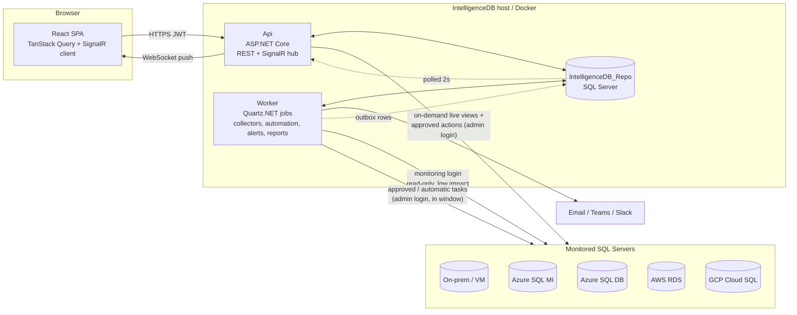
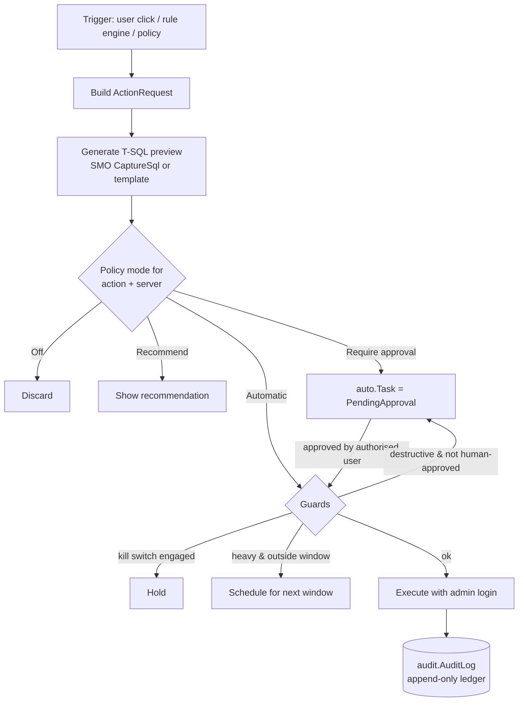

# IntelligenceDB — Phase 0 Design

Status: **approved**. Phase 1 is implemented (see README.md). Development and testing run in GitHub Codespaces
(`.devcontainer/`) because the author's machine has no .NET SDK or Docker.

---

## 1. Key decisions (and why)

| Area | Choice | Reason |
|---|---|---|
| Runtime | **.NET 10 (LTS)**, C# 14 | Current LTS line (supported to Nov 2028). .NET 11 is STS. |
| Scheduler | **Quartz.NET** (ADO job store in repo DB) | Apache-2.0, cron + calendars (maintenance windows), clustering so 2+ Workers can share load. Hangfire's useful features (batches, throttling) are paid. |
| Repo DB | **SQL Server 2022** (2025 also supported) | Gives **append-only ledger tables** for a tamper-evident audit log. On older/Express repos we fall back to deny-update triggers + hash chain. |
| Data access | Repo: **EF Core 10** (migrations) + Dapper for bulk metric inserts. Targets: **Dapper + Microsoft.Data.SqlClient 6**; **SMO** for admin actions. | EF for schema evolution; Dapper for fast, explicit DMV SQL; SMO's *CaptureSql* mode produces the exact T-SQL for every dry-run preview. |
| Real-time | **SignalR hub hosted in the API**. Worker → API via an **outbox table** polled every 2 s. Live sessions/blocking are pulled *by the API on demand*, only while someone is watching that server. | No Redis dependency; no permanent heavy polling of targets. |
| Resilience | **Polly v8**: per-server timeout, retry with jitter, **circuit breaker** (unreachable server backs off, never stalls others). | Requirement: one bad server never breaks the collector/dashboard. |
| Concurrency | Global `SemaphoreSlim` (default **16** parallel servers, configurable) + per-server lock (no overlapping runs of the same collector). | Scales to 50+ servers with predictable load. |
| Auth (portal) | ASP.NET Core Identity + **JWT access token (15 min)** + **refresh token in httpOnly, Secure, SameSite=Strict cookie**. TOTP 2FA. Optional Entra ID SSO (Microsoft.Identity.Web). | Tokens never in localStorage. |
| Secrets | **ASP.NET Data Protection**; key ring persisted to repo DB and itself protected by a certificate (Docker) or DPAPI-machine (IIS); optional **Azure Key Vault** key-wrapping provider. | Secrets encrypted at rest, never returned to the UI (write-only fields). |
| Frontend | React 19, TypeScript, Vite, Tailwind v4, shadcn/ui, **TanStack Query + TanStack Table**, React Router, Apache ECharts, `@microsoft/signalr`. | As specified; TanStack Table gives sorting/filtering/paging/export. |
| Reports | **ClosedXML** (Excel, MIT) + **QuestPDF** (PDF). | QuestPDF Community licence is free under USD 1M annual revenue — **you must confirm you qualify**, otherwise I'll swap to a different PDF engine. |
| Tests | xUnit v3, **Shouldly** (not FluentAssertions v8 — now commercial), NSubstitute, **Testcontainers** (`mcr.microsoft.com/mssql/server:2022-latest`). | Real SQL Server in integration tests. |
| Windows auth to targets | Supported when API/Worker run on a **domain-joined Windows host (IIS / Windows service)**. In Linux Docker it needs Kerberos keytab config — documented as advanced, off by default. | Safest realistic default. |
| Community tools | Ola Hallengren (MIT) and First Responder Kit (MIT) scripts are **not bundled**; downloaded from their official GitHub release at deploy time, after explicit confirmation, with attribution shown. | Respects licences, always current. |

---

## 2. Architecture



### Collection pipeline (one tick)

```mermaid
sequenceDiagram
  participant Q as Quartz trigger
  participant O as CollectorOrchestrator
  participant C as ICollector (e.g. WaitStats)
  participant T as Target SQL
  participant R as Repo
  Q->>O: tick (collector X)
  O->>O: pick due servers, skip paused / circuit-open / unsupported capability
  par up to N servers
    O->>C: CollectAsync(server, ct)
    C->>T: SET LOCK_TIMEOUT 3000; READ UNCOMMITTED; timeout 30s
    T-->>C: rows
    C->>R: bulk insert (Dapper / SqlBulkCopy)
  end
  O->>R: mon.CollectionRun (status, ms, error)
  O->>R: outbox → "server health changed"
```

### Action pipeline (every change to a target goes through this)



Hard rule in code (not configuration): `IsDestructive` actions (DROP INDEX, KILL, job delete, sp_configure change, …) can **never** reach *Execute* without a human approval record, regardless of policy mode.

---

## 3. Solution structure

```
IntelligenceDB/
├─ IntelligenceDB.sln
├─ Directory.Build.props          # net10.0, Nullable, TreatWarningsAsErrors, analyzers
├─ Directory.Packages.props       # central package versions
├─ src/
│  ├─ IntelligenceDB.Domain/              # entities, enums, value objects, NO dependencies
│  │   ├─ Servers/ (Server, ServerGroup, Credential, PlatformType, Capability)
│  │   ├─ Monitoring/  Automation/  Alerts/  HealthChecks/  Audit/  Reports/
│  ├─ IntelligenceDB.Application/         # use cases, interfaces, DTOs, validation
│  │   ├─ Abstractions/ (ITargetConnectionFactory, ICapabilityService, ISecretProtector,
│  │   │                 IActionExecutor, IAlertChannel, IClock, IAuditWriter …)
│  │   ├─ Servers/ Dashboard/ Databases/ Jobs/ Indexes/ Performance/ Security/
│  │   ├─ HealthChecks/ (rule engine — pure, unit-tested)
│  │   ├─ Automation/  (policy evaluator — pure, unit-tested)
│  │   └─ Alerts/ Reports/
│  ├─ IntelligenceDB.Infrastructure/      # EF Core, Dapper, SMO, Data Protection, Polly, channels
│  │   ├─ Repository/ (RepoDbContext, Migrations/, Configurations/)
│  │   ├─ Targets/ (ConnectionFactory, CapabilityDetector, Sql/ *.sql as embedded resources)
│  │   ├─ Collectors/ (one class per collector)
│  │   ├─ Admin/ (SMO-based executors, T-SQL generators)
│  │   ├─ Alerting/ (SmtpChannel, TeamsChannel, SlackChannel, InAppChannel)
│  │   └─ Reporting/ (QuestPDF, ClosedXML)
│  ├─ IntelligenceDB.Api/                 # controllers/minimal APIs, SignalR hub, auth, rate limiting
│  ├─ IntelligenceDB.Worker/              # Quartz host, job classes, outbox writer
│  └─ IntelligenceDB.Web/                 # React + Vite app
│      └─ src/ (app/, components/ui (shadcn), features/<module>/, lib/api, lib/signalr, hooks/)
├─ tests/
│  ├─ IntelligenceDB.UnitTests/           # rule engine, policy logic, capability matrix, T-SQL generators
│  └─ IntelligenceDB.IntegrationTests/    # Testcontainers SQL Server: collectors, capability detection, actions
├─ sql/
│  ├─ repository/ (00-create-database.sql, idempotent migration bundle script)
│  ├─ monitoring-login/ (onprem.sql, azure-mi.sql, azure-sqldb.sql, aws-rds.sql, gcp-cloudsql.sql)
│  └─ admin-login/      (same five platforms)
├─ deploy/
│  ├─ docker-compose.yml, .env.example, api.Dockerfile, worker.Dockerfile, web.Dockerfile (nginx)
│  └─ iis/ (web.config, install-worker-service.ps1)
└─ docs/ ARCHITECTURE.md, FEATURES-BY-PLATFORM.md, PHASE-0-DESIGN.md (this file)
```

Every target-side query lives in its own `.sql` embedded resource (reviewable by a DBA, no string-built SQL). Object names that must appear in DDL (index/table names in generated maintenance T-SQL) come **only from metadata the collector read**, are re-validated against `sys.objects` before execution, and are always wrapped with `QUOTENAME` server-side.

---

## 4. Capability detection

On *Test Connection* and every 6 h the Worker runs a detection script and stores results in `inv.ServerCapability`.

Detection inputs:
- `SERVERPROPERTY('EngineEdition')` → 5 = Azure SQL DB, 8 = Azure SQL MI, else box product.
- `SERVERPROPERTY('ProductVersion'/'ProductLevel'/'ProductUpdateLevel'/'Edition')`.
- RDS: existence of `msdb.dbo.rds_backup_database` / `rdsadmin` database. GCP Cloud SQL: `cloudsqladmin` principals / `msdb.dbo.gcloudsql_*` markers (fallback: user-declared platform; detected value shown alongside).
- Permissions: `fn_my_permissions(NULL,'SERVER')`, `IS_SRVROLEMEMBER('sysadmin')`, msdb role membership (`SQLAgentReaderRole`, `db_datareader`), `HAS_PERMS_BY_NAME` checks per DMV group.
- Feature probes: Query Store state per DB, Agent running (`sys.dm_server_services` where allowed), `sys.dm_os_volume_stats` availability, `system_health` XE readable.

Each feature module declares `RequiredCapabilities` (e.g. Jobs → `MsdbAccess`, `SqlAgent`). The API returns `{ supported, reason, alternative }` per feature per server; the UI disables/hides with that explanation. Every collector call is additionally wrapped so a missing object (error 208/229/297/300/40515 etc.) is recorded as "capability lost" instead of crashing.

---

## 5. Repository database schema (`IntelligenceDB_Repo`)

Schemas: `auth`, `inv`, `mon`, `hc`, `auto`, `alert`, `rpt`, `audit`, `ops`, `cfg`, `log`, `qrtz`.
All times are **UTC `datetime2(3)`**. Mutable config tables carry a `rowversion` for optimistic concurrency.

### 5.1 Identity & access (`auth`)
| Table | Key columns |
|---|---|
| ASP.NET Identity tables (`auth.Users`, `Roles`, `UserRoles`, `UserTokens`, …) | standard; roles seeded: Admin, DBA, Operator, Viewer |
| `auth.RefreshToken` | Id, UserId, TokenHash, ExpiresUtc, RevokedUtc, ReplacedById, CreatedIp |
| `auth.UserScope` | UserId, ServerGroupId (NULL = all groups) |

### 5.2 Inventory (`inv`)
| Table | Key columns |
|---|---|
| `inv.ServerGroup` | Id, Name, Description, ParentId |
| `inv.Server` | Id, DisplayName, Host, Port, InstanceName, DeclaredPlatform, DetectedPlatform, Environment (Prod/Test/Dev), GroupId, MonitoringCredentialId, AdminCredentialId NULL, CollectionProfile, IsEnabled, IsPaused, TimeZoneId, CreatedUtc, RowVersion |
| `inv.ServerTag` | ServerId, Tag (PK both) |
| `inv.Credential` | Id, Purpose (Monitoring/Admin), AuthType (Sql/Windows/EntraPassword/EntraServicePrincipal/EntraManagedIdentity/EntraDefault), UserName, **ProtectedSecret varbinary(max)**, TenantId, ClientId, CreatedUtc, RotatedUtc |
| `inv.ServerInfo` | ServerId (PK), ProductVersion, ProductLevel, UpdateLevel, Edition, EngineEdition, HostPlatform, CpuCount, PhysicalMemoryMB, StartTimeUtc, Collation, IsHadrEnabled, IsSysadmin, PermissionsJson, DetectedUtc |
| `inv.ServerCapability` | ServerId, CapabilityKey, IsSupported, Reason, Alternative, DetectedUtc |
| `inv.ServerConfig` | ServerId, Name, ValueInUse, Value, CollectedUtc (sp_configure snapshot) |
| `inv.Database` | Id, ServerId, Name, SourceDatabaseId, CreateDateUtc, StateDesc, RecoveryModel, CompatLevel, Owner, IsQueryStoreOn, FirstSeenUtc, LastSeenUtc, IsDropped |
| `inv.AgentJob` | Id, ServerId, JobId (guid), Name, Category, Owner, IsEnabled, Description, LastSeenUtc, IsDeleted |
| `inv.AgentJobSchedule` | Id, AgentJobId, ScheduleId, Name, FrequencyJson, IsEnabled, NextRunUtc |
| `inv.SqlBuildCatalog` | MajorVersion, Build, CuLabel, ReleaseDate, IsLatest (used to flag outdated CUs; refreshable) |

### 5.3 Monitoring history (`mon`)
High-volume tables use clustered index `(ServerId, CollectedUtc)` and **page compression**; optional monthly partitioning when repo edition allows. Hourly/daily roll-ups keep long trends cheap; raw data purged by retention settings.

| Table | Content |
|---|---|
| `mon.CollectionRun` | Id, ServerId, Collector, StartedUtc, DurationMs, Status, RowsWritten, Error |
| `mon.ServerMetric` | ServerId, CollectedUtc, SqlCpuPct, OtherCpuPct, PageLifeExpectancy, MemoryGrantsPending, TotalServerMemoryMB, TargetServerMemoryMB, BatchReqPerSec, CompilationsPerSec, UserConnections, BlockedSessions |
| `mon.ServerMetricHourly` | same metrics: avg/max per hour |
| `mon.WaitStat` | ServerId, CollectedUtc, WaitType, WaitTimeMsDelta, SignalMsDelta, TasksDelta (deltas vs previous sample; reset on restart detected) |
| `mon.FileIo` | ServerId, CollectedUtc, DatabaseName, FileId, ReadsDelta, WritesDelta, ReadStallMsDelta, WriteStallMsDelta, BytesRead/WrittenDelta |
| `mon.DatabaseFile` | DatabaseId, CollectedUtc, FileId, LogicalName, PhysicalName, TypeDesc, SizeMB, UsedMB, GrowthDesc, MaxSizeMB, VolumeMountPoint |
| `mon.Volume` | ServerId, CollectedUtc, MountPoint, TotalMB, FreeMB |
| `mon.DatabaseHealth` | DatabaseId, CollectedUtc, VlfCount, LogReuseWait, LogUsedPct, LastCheckDbUtc, LastFullUtc, LastDiffUtc, LastLogUtc |
| `mon.Backup` | Id, DatabaseId, BackupSetUuid (unique per server), Type, StartUtc, FinishUtc, SizeBytes, CompressedBytes, IsCopyOnly, DeviceType, PhysicalDevice |
| `mon.JobRun` | Id, AgentJobId, SourceInstanceId, RunStartUtc, DurationSec, Outcome, Message |
| `mon.JobStepRun` | Id, JobRunId, StepId, StepName, RunStartUtc, DurationSec, Outcome, SqlMessageId, Severity, Message |
| `mon.IndexStat` | DatabaseId, CollectedUtc, SchemaName, TableName, IndexName, IndexId, TypeDesc, PageCount, FragmentationPct, SizeMB, Seeks, Scans, Lookups, Updates, LastUserSeekUtc… |
| `mon.MissingIndex` | DatabaseId, CollectedUtc, TableName, EqualityCols, InequalityCols, IncludedCols, UserSeeks, AvgTotalUserCost, AvgUserImpact, ImpactScore |
| `mon.StatisticStat` | DatabaseId, CollectedUtc, TableName, StatName, LastUpdatedUtc, Rows, RowsSampled, ModificationCounter |
| `mon.QueryText` | QueryHash (PK with ServerId), Text (nvarchar(max), truncated 64 KB) |
| `mon.QueryStat` | ServerId, CollectedUtc, Source (PlanCache/QueryStore), DatabaseName, QueryHash, PlanHash, ExecDelta, CpuMsDelta, DurationMsDelta, LogicalReadsDelta |
| `mon.PlanRegression` | ServerId, DatabaseName, QueryId, OldPlanId, NewPlanId, OldAvgMs, NewAvgMs, DetectedUtc |
| `mon.BlockingEvent` | Id, ServerId, CapturedUtc, HeadBlockerSpid, ChainJson, MaxWaitSec |
| `mon.Deadlock` | Id, ServerId, EventUtc, XdlHash (dedupe), DeadlockXml, SummaryJson |

### 5.4 Health checks (`hc`)
| Table | Key columns |
|---|---|
| `hc.Rule` | Id (code e.g. `BKP001`), Category, DefaultSeverity, Title, Explanation, Recommendation, IsEnabled |
| `hc.RuleOverride` | RuleId, ScopeType, ScopeId, Severity, IsEnabled, ParametersJson |
| `hc.Finding` | Id, ServerId, RuleId, DatabaseName, Severity, DetailJson, FirstSeenUtc, LastSeenUtc, Status (Open/Resolved/Suppressed), SuppressedUntilUtc |
| `hc.HealthScore` | ServerId, CalculatedUtc, Score, BreakdownJson |

### 5.5 Automation (`auto`)
| Table | Key columns |
|---|---|
| `auto.Policy` | Id, ActionType, ScopeType (Global/Group/Server), ScopeId, Mode (Off/Recommend/RequireApproval/Automatic), ThresholdsJson, RowVersion. Most specific scope wins. |
| `auto.MaintenanceWindow` | Id, ScopeType, ScopeId, DaysMask, StartLocal, EndLocal, TimeZoneId (windows may cross midnight) |
| `auto.KillSwitch` | ScopeType (Global/Server), ScopeId, IsEngaged, Reason, ChangedBy, ChangedUtc |
| `auto.Task` | Id, ServerId, DatabaseName, ActionType, TargetObject, Status (Recommended/PendingApproval/Approved/Rejected/Scheduled/Running/Succeeded/Failed/Cancelled/Expired), IsDestructive, IsHeavy, TsqlPreview, Origin (User/Policy/Rule), RequestedBy, ApprovedBy, ApprovedUtc, NotBeforeUtc, ExpiresUtc, StartedUtc, FinishedUtc, Error, RowVersion |
| `auto.ScheduledTask` | IntelligenceDB's own scheduler for Azure SQL DB (replacement for Agent): Id, ServerId, DatabaseName, Name, Tsql (Admin-authored, audited), Cron, IsEnabled |

### 5.6 Alerts (`alert`)
| Table | Key columns |
|---|---|
| `alert.Rule` | Id, Type (JobFailed/JobLong/MissingBackup/DiskLow/Blocking/Deadlock/HighCpu/Unreachable/CheckDbOverdue/HealthFinding), ScopeType, ScopeId, ThresholdsJson, Severity, IsEnabled, CooldownMinutes |
| `alert.Channel` | Id, Type (InApp/Email/Teams/Slack/…), Name, **ProtectedConfig varbinary(max)**, IsEnabled |
| `alert.RuleChannel` | RuleId, ChannelId, MinSeverity |
| `alert.Event` | Id, RuleId, ServerId, Fingerprint (dedupe key), Severity, Title, DetailJson, State (Open/Acknowledged/Snoozed/Resolved), FirstUtc, LastUtc, OccurrenceCount, SnoozedUntilUtc, AckBy |
| `alert.Delivery` | Id, EventId, ChannelId, AttemptUtc, Status, Error |
| `alert.UserNotification` | Id, UserId, EventId, IsRead (in-app bell) |

### 5.7 Reports (`rpt`)
`rpt.Schedule` (Id, Name, Type, ScopeType, ScopeId, Cron, Format PDF/XLSX, Recipients) · `rpt.Run` (Id, ScheduleId, StartedUtc, Status, FileBlobId, Error) · `rpt.File` (Id, ContentType, Content varbinary(max), CreatedUtc, ExpiresUtc).

### 5.8 Audit (`audit`) — immutable
`audit.AuditLog` — **SQL Server append-only ledger table** (`LEDGER = ON (APPEND_ONLY = ON)`):
Id bigint, OccurredUtc, UserId, UserName, ClientIp, Action, ServerId, ServerName, DatabaseName, TaskId, Tsql, Result (Succeeded/Failed/Denied), DurationMs, Error, CorrelationId.
Fallback on repos without ledger: `DENY UPDATE, DELETE` to the app role, `INSTEAD OF UPDATE, DELETE` trigger that raises, plus a SHA-256 hash chain column (`PrevHash`, `RowHash`) verified by a health check. Also audits portal events: logins, failed logins, settings/policy changes, credential changes (never the secret).

### 5.9 Operations / config / logs
`ops.Outbox` (Id, Topic, PayloadJson, CreatedUtc, ProcessedUtc) · `ops.DataProtectionKey` (key ring) · `cfg.Setting` (Key, Value, RowVersion — retention days, concurrency, SMTP etc.) · `log.AppLog` (Serilog MSSqlServer sink, 30-day retention) · `qrtz.*` (Quartz ADO store).

---

## 6. Low-impact collection rules (enforced in the shared connection helper)

- Every target session: `SET LOCK_TIMEOUT 3000; SET DEADLOCK_PRIORITY LOW; SET TRANSACTION ISOLATION LEVEL READ UNCOMMITTED` (only for DMV/catalog reads), `ApplicationName=IntelligenceDB-Collector`, command timeout 30 s (configurable).
- Per-collector default intervals (user-overridable per server): metrics 60 s · waits/file IO 5 min · DB files/backups/jobs 5–15 min · query stats 15 min · indexes/statistics **daily, inside maintenance window or off-hours only**, using `sys.dm_db_index_physical_stats(... 'LIMITED')` and a page-count floor · capability/config 6 h.
- Never touch user tables; never `SELECT *` from large DMVs; plan XML fetched only on demand.
- Unreachable server → circuit opens, backoff to 5 min, "Server unreachable" alert, dashboard shows last known data marked stale.

---

## 7. Health score (initial model, all weights configurable)

Start at 100, subtract per active signal, floor 0: Unreachable → score 0 · CPU > 90% sustained 15 min −15 · memory pressure (PLE drop / grants pending) −10 · top-wait signature (e.g. PAGEIOLATCH / RESOURCE_SEMAPHORE dominant) −5 to −10 · failed jobs (24 h) −5 each, max −15 · missing full backup (> N days) −15, missing log backup on FULL recovery −10 · blocking > threshold −10 · volume < 10% free −15 · CHECKDB older than N days −10 · critical health-check findings −5 each. Breakdown is stored so the UI explains every lost point.

---

## 8. Phase plan

| Phase | Scope | You can test |
|---|---|---|
| **1** | Solution + central package mgmt, warnings-as-errors; repo DB + EF migrations (schemas above, created incrementally per phase); Identity + JWT + refresh cookie + 2FA + roles + group scopes; Data Protection key ring; server CRUD, groups, tags, credentials (encrypted), **Test Connection + capability detection** (all 5 platforms); basic dashboard (server cards, reachability, version); React shell (sidebar, dark/light, auth pages, global search stub over servers); login scripts per platform in `sql/`. | Log in, add a real server, see detected platform/permissions/capabilities, see it on the dashboard. |
| **2** | Worker + Quartz + orchestrator (concurrency, circuit breaker, CollectionRun log); collectors: server info/config, metrics, waits, file IO, DB files/volumes, DB health (VLF, log reuse, CHECKDB date), backups; Server Overview & Databases pages with ECharts trends; sp_configure best-practice warnings; outdated-CU flag; retention/roll-up job; health score v1. | Watch charts fill; drop a backup and see "missing backup". |
| **3** | Jobs: inventory, schedules, history w/ step output, duration baseline & "running longer than usual"; controls start/stop/enable/disable/edit schedule via SMO with T-SQL preview + confirmation + audit; Azure SQL DB notice + IntelligenceDB scheduler; alert engine core + in-app + email for job failure; SignalR running-jobs feed. | Start/stop a real job, fail one and receive an alert. |
| **4** | Index intelligence (fragmentation, usage, missing, unused, duplicate/overlap, stats) + exact T-SQL generators (ONLINE when edition allows); Query performance (plan cache + Query Store, regressions, plan XML download + summary); live sessions/requests; live blocking chains; deadlock history from `system_health`; kill session (Admin, confirmed, audited). | Create blocking and a deadlock in a test DB and see both. |
| **5** | Automation engine: policies & scope resolution, maintenance windows, thresholds, task queue, approvals UI, dry-run, kill switches, executor, ledger audit log + Audit Log page. | Set index maintenance to "Require approval", approve a task, see it run in the window and in the audit log. |
| **6** | Security module (logins, roles, sysadmins, orphaned users, policy-off logins, permission report); health-check rule engine (~40 rules initially) + findings UI; optional Ola/FRK deploy with confirmation; Teams/Slack channels, dedupe, snooze; scheduled PDF/Excel reports. | Run health checks, receive Teams/Slack alerts, get a weekly PDF. |
| **7** | Polish (tooltips everywhere, exports, tablet layout), full unit + Testcontainers integration suite, Docker Compose, IIS guide, 50-server load test of collector, README, ARCHITECTURE.md, FEATURES-BY-PLATFORM.md. | `docker compose up` from clean machine. |

After each phase I will give: how to run, what to test, and any manual steps — then wait for your confirmation.

---

## 9. Manual prerequisites on this machine

Detected on `E:\IntellingenceDb`: folder is empty, **Node.js 24 is installed**, but **.NET SDK and Docker are not installed**.

1. Install **.NET 10 SDK** (https://dotnet.microsoft.com/download/dotnet/10.0).
2. Install **Docker Desktop** (for the repo SQL Server container + integration tests), *or* have a SQL Server 2022/2025 instance (Developer edition is free) you can point the repo connection string at.
3. Have at least one test SQL Server you can monitor (the Docker container can double as the first target).

I can write Phase 1 code before these are installed, but I can't compile or run it until the .NET SDK is present — I'll tell you clearly if anything is unverified.
